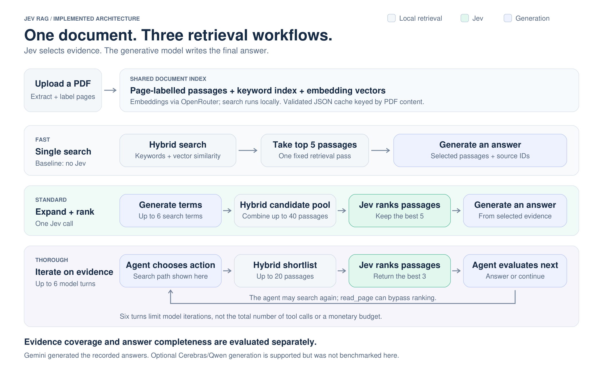
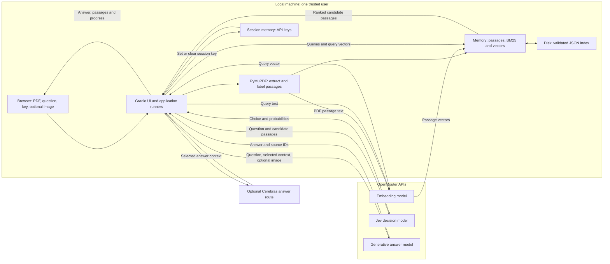
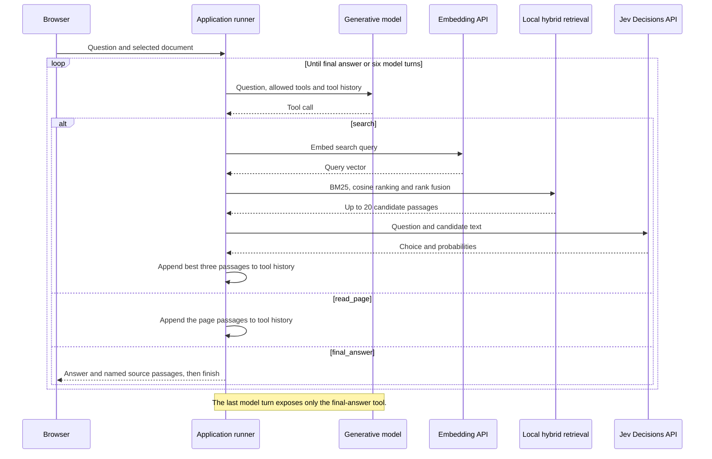
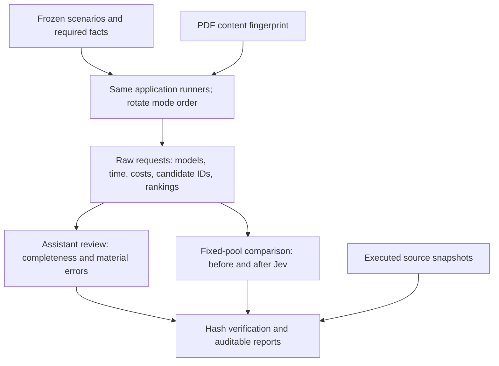

# Architecture, decisions and engineering challenges

This document describes the implemented system. Proposed improvements are identified as such. It does not imply a vector-database service, automatic model router or production deployment that the code does not implement.

## 1. System boundaries and data flow

The application is local; inference is remote. Keyword scores, cosine similarity and rank fusion run in the Python process. Creating embeddings, Jev decisions and answer generation require provider requests.

The browser sends its entered keys to the local server. The application holds them in per-session memory, not browser persistence or the index. Provider requests authenticate with the relevant key. Document text and optional images cross the provider boundary; a local UI does not mean local inference. See [PRIVACY.md](PRIVACY.md).

The document index is shared process state, not a tenant-isolated database. The app binds to loopback and assumes one trusted user. Uploaded files are managed by Gradio; clearing the UI selection does not promise removal of every cached or temporary file.

## 2. Prepare once, retrieve repeatedly

1. Hash the PDF bytes with SHA-256. A renamed but unchanged PDF can reuse its index; changed bytes produce a different identity.
2. Extract each page's text and attach its page number and available table-of-contents heading. Split long pages into passages of up to 300 words; passages shorter than 25 words are excluded. Heading labels come from the most recent table-of-contents entry by page position; a section change within a page can make a label imprecise.
3. Build BM25 locally and obtain embedding vectors through OpenRouter. Embedding batches contain up to 100 passages, with up to eight indexing workers.
4. Persist document text, labels and vectors as data-only JSON. Validate schema, model compatibility, dimensions and finite numeric values when loading; rebuild BM25 from the cached text.
5. Retain up to three indexes in memory and ten saved indexes on disk. The disk record checks the embedding model and schema version; a chunking change also requires deliberate cache-version invalidation.

This avoids indexing the whole manual for every question. It does not eliminate query-embedding or answer-generation requests. The cache stores extracted document contents and therefore belongs inside the privacy boundary.

There is no external vector database. Similarity search is a local linear scan over the stored vectors, adequate for the measured single-manual experiment but not evidence of large-corpus scale. A larger corpus would justify measuring an indexed search engine rather than assuming this design scales unchanged.

## 3. Three strategies, one event contract

Each runner yields `stage`, `step` and `done` events. The UI consumes these to show progress, selected passages, time and cost. The benchmark invokes the same runners directly, which reduces drift between the measured logic and the application. It does not make the benchmark a browser end-to-end test.

| Mode | Retrieval strategy | Decision and answer boundary |
|---|---|---|
| Fast | Search the original question with BM25 and embedding similarity; fuse the rankings; take five passages | No Jev call. The answer model receives that fixed context. |
| Standard | Generate up to six focused search terms; search the original question and unique terms; merge results round-robin into at most 40 candidates | Jev ranks the pool; the answer model receives five passages. |
| Thorough | The model chooses search, read a full page or final answer; each search fuses a shortlist of 20 candidates | Jev ranks each search's candidates and returns three passages to the agent. A page read bypasses Jev. |

Reciprocal-rank fusion combines positions rather than adding incompatible BM25 and cosine score scales. Standard batches its question and generated terms into one embedding request. Query expansion can recover vocabulary from different parts of a multi-constraint question, but also changes the candidate set—an important confounder when measuring Jev's benefit.

Jev's response is a choice with probabilities. The code sorts the candidates by those probabilities. A probability is not a measured correctness guarantee, and selecting individually relevant passages does not guarantee coverage of every part of a question.

### Thorough: tool execution is bounded by model turns

Six model turns are not a strict tool-call or monetary budget: a turn can return multiple tool calls, and searches make additional embedding and decision requests. The model decides when to stop. A hard request/token/spend budget and explicit cancellation semantics would be additional work, not properties already established by this prototype.

## 4. Decisions and tradeoffs

| Challenge | Implemented choice and reason | What the choice does not solve |
|---|---|---|
| A long question mixes several topics | Focused query expansion plus hybrid retrieval can recover complementary passages. In the six-task diagnostic, Fast declined five tasks with incomplete retrieved context. | Better answers in Standard cannot all be credited to Jev; query expansion also changes retrieval. |
| A candidate pool contains near-matches | Jev separates passage selection from prose generation. Fixed-pool traces preserve the input order and resulting ranking. | Top-five relevance is not multi-evidence completeness or entailment verification. |
| Passing the whole document is expensive | Limit selected context to five passages, or three per agent search; reuse the document index. | More searches and longer tool histories can still increase time and cost. There is no enforced dollar cap. |
| Procedures span passage boundaries | Preserve pages and offer `read_page` in Thorough so the agent can request surrounding text. | Word-based splitting can separate conditions from instructions; short passages may be dropped. Parent-section retrieval or overlap would need evaluation before adoption. |
| A filename is not a stable content identity | Use the document fingerprint, embedding-model compatibility and cache schema version. | A future chunking-policy change needs an explicit version decision; the cache is not automatically aware of arbitrary code edits. |
| Local state can outlive a browser view | Session-only keys, owner-only cache files on POSIX, data-only JSON, validated fingerprints and ignored runtime data. | This is not multi-user authorization, provider retention control or guaranteed erasure of uploaded documents. |
| Provider failures must be observable | Surface failures separately from successful answers; retain per-request model, timing and returned usage in benchmark traces. | Retry classification is coarse. Charges from failed attempts are not a complete financial ledger; a successful response's usage alone cannot prove total billing. |

### Citations are an inspectable boundary, not a proof

Fast and Standard filter returned citation IDs against the passages supplied to their answer call. Thorough filters final IDs against the document index, which is weaker: a valid document ID does not establish that the agent inspected that passage. None of the modes performs a deterministic semantic check that every answer claim is entailed by its citations.

That distinction is why the evaluation checks required facts rather than just the presence of a page number. A stronger implementation would require agent citations to have appeared in tool results and would separately assess claim support, omissions and justified abstention. These are proposed improvements, not implemented guarantees.

### Provider selection is explicit

The answer-provider dictionary supports Gemini through OpenRouter and an optional Qwen route through Cerebras. The UI lets the user choose. This is not an automatic cost/quality router; embeddings and Jev remain tied to OpenRouter. Provider availability, an alpha Decisions endpoint and a `latest` model alias are dependencies that can change between runs, so requests and source versions are recorded.

## 5. Evaluation is part of the architecture

Two different questions are measured:

- **Can the workflow answer the task?** Six multi-section support scenarios have 24 preregistered required facts. The assistant review assigns covered, partial or missing labels and records its limitations. This measures diagnostic completeness, not representative production accuracy.
- **What did Jev change on the same input?** Standard's traces compare five candidates before and after Jev on each unchanged pool. Canonical evidence coverage increased from 11/23 to 18/23 across those cases. This isolates a ranking contribution, not Jev's causal effect on the final answer and not all possible valid evidence in a repetitive manual.

The raw measurements, fixed criteria, individual grades and original source snapshots are included. One rubric item was overly demanding relative to its question; the review explicitly flags it. The ten-question timing smoke test is kept separate from the harder diagnostic. No screenshots, broad enterprise test set, repeated-run confidence interval or independent blinded grading were evaluated.

See [the accuracy review](docs/comparisons/2026-10-26-accuracy-review.md), [protocol](benchmarks/accuracy-protocol.md) and [evidence verifier](scripts/verify_evidence.py).

## 6. Source map and maintainability

| Responsibility | Implemented source |
|---|---|
| UI, PDF ingestion, progress events and in-memory document cache | [app.py](app.py) |
| Data-only persistent index and compatibility validation | [index_store.py](index_store.py) |
| Fast baseline and shared final-answer call | [classic.py](classic.py) |
| Focused query generation, pooling and Standard Jev ranking | [keywords.py](keywords.py) |
| Agent tools, repeated searches and per-search Jev ranking | [agent.py](agent.py) |
| Embedding/decision HTTP helpers and BM25 | [poc.py](poc.py) |
| Rank fusion and cosine-search helpers reused from research | [ableton_eval.py](ableton_eval.py), [squad_eval.py](squad_eval.py) |
| Mode comparison, request instrumentation and report generation | [benchmarks/compare_search_modes.py](benchmarks/compare_search_modes.py) |

The flat modules reuse research helpers to avoid duplicating algorithms. That keeps a small experiment inspectable, but it couples runtime code to experiment modules. A larger application should extract common retrieval primitives and a provider-client interface before adding more modes; the current diagrams do not pretend that refactor has already happened.

The overview image is reproducible with `python scripts/render_architecture.py --png`. Its [SVG](docs/diagrams/search-modes.svg) is included; the detailed diagrams above use editable Mermaid syntax directly in this document.
