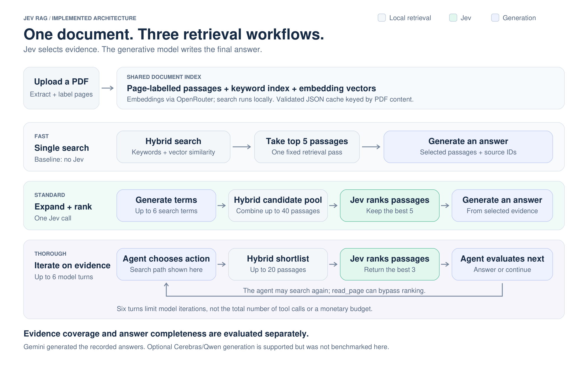

# Jev RAG

Ask practical questions about a long PDF and inspect the passages behind each answer. This proof of concept explores whether a decision model, **Jev**, can improve the selection of evidence for a generative answer model.

[Run locally](#start-the-app) · [Architecture](docs/architecture.md) · [Evaluation](#evaluation)

The application offers three retrieval workflows. The benchmark records Jev's ranking on fixed candidate pools, so its contribution can be inspected separately from query expansion.



**Read the diagram:** gray is local retrieval, green is Jev selecting evidence, and blue is the generative model. All three modes reuse the same document index. Jev is a decision layer in Standard and Thorough; Fast is the control without it.

[Architecture, data flow and engineering tradeoffs](docs/architecture.md) · [Editable SVG](docs/diagrams/search-modes.svg)

| Search mode | What happens | Jev's role |
|---|---|---|
| **Fast** | One hybrid keyword/embedding search, then an answer from five passages | Baseline without Jev |
| **Standard** | Generate focused queries, combine their results, then answer from five selected passages | Ranks up to 40 candidates |
| **Thorough** | An agent can search again or read a page before answering | Ranks the candidates for each search |

Gemini writes the final answers in the recorded comparisons. Jev selects evidence; it does not generate the answer prose. An optional Cerebras/Qwen route is also implemented but was not part of those comparisons.

## Architecture decisions and challenges

| Engineering question | Decision in this prototype | Evidence or limitation |
|---|---|---|
| How do we recover evidence spread across sections? | Hybrid retrieval plus focused query expansion; an agent can read a full page. | Fast declined five multi-part diagnostic tasks when its retrieved context was incomplete. |
| Where does Jev contribute? | Rank candidate passages before answer generation and record the before/after lists. | On identical Standard pools, canonical evidence in the chosen five rose from 11/23 to 18/23. |
| How are cost and latency controlled? | Cache document indexes, cap selected context, and limit the agent to six model turns. | This is not a hard request or spending budget; tool calls add provider requests. |
| How do we avoid overstating grounded answers? | Show source passages and evaluate required facts separately from page hits. | Valid citation IDs do not prove semantic support; the agent's citation check is weaker than the fixed-context modes. |
| Why keep storage local? | Inspectable JSON caches and local ranking make the experiment easy to reproduce. | Linear similarity search and shared process state are single-user choices, not a large-scale hosted architecture. |

The [architecture document](docs/architecture.md) includes the provider boundary, agent sequence, evaluation design, source map and the limits of each decision. Proposed improvements are separated from implemented behavior.

## Start the app

Requires Python 3.11+ and an OpenRouter API key. From this repository's root:

```bash
python3 -m venv .venv
.venv/bin/python -m pip install -r requirements.txt
.venv/bin/python app.py
```

Open the local URL printed by Gradio. Enter your own OpenRouter key, upload [the included demo PDF](examples/support-handbook.pdf), wait until it is ready, and try the same question with each search mode. On Windows, use `.venv\Scripts\python` in place of `.venv/bin/python`.

API keys are held in memory for the active app session. Re-enter them after a page reload; **Remove keys** clears the active state. They are not persisted in browser storage or written into the index. Uploaded PDFs are processed by OpenRouter and the configured model providers. Use the synthetic demo or documents you are comfortable sending to those providers.

The demo handbook is fictional and intended to demonstrate operation. It is not the accuracy test corpus.

## Repository layout

```text
app.py                 Local app launcher
jev_rag/               UI, search modes, provider client and shared retrieval
benchmarks/            Three-mode runner, frozen cases and executed-source evidence
experiments/           Historical retrieval studies, fixtures and saved results
docs/                  Architecture, usage, privacy, diagrams and diagnostic reports
examples/              Synthetic demo PDF
tests/                 Offline regression tests
scripts/               Evidence verification and architecture rendering
data/                  Ignored uploads, generated documents and index caches
```

The application has no dependency on the experiment modules. BM25, vector ranking and rank fusion live in `jev_rag/retrieval.py`; provider requests live in `jev_rag/api.py`. See [the experiment guide](experiments/README.md) for the older research commands and result files.

## Documentation

- [Architecture](docs/architecture.md) — data flow, design decisions and engineering tradeoffs.
- [Retrieval pipelines](docs/jev-pipeline.md) — the three search modes and their implementation.
- [Evaluation methodology and results](docs/comparisons/2026-10-26-accuracy-review.md) — diagnostic tasks, scoring criteria and limitations.
- [Recorded benchmark data](docs/comparisons/2026-10-26-jev-troubleshooting.json) — answers, provider usage and Jev ranking traces.
- [Running the benchmarks](benchmarks/README.md) — reproduction instructions and experiment coverage.

## Evaluation

The six-task technical-support diagnostic uses an 867-page manual and 24 required facts committed before the run. Answers were assessed for completeness against source evidence using an assistant-scored rubric.

| Mode | Required-fact points / 24 | Median whole-answer time | Mean API cost per task |
|---|---:|---:|---:|
| Fast | 4 | 16.20 s | $0.007569 |
| Standard | 23 | 18.18 s | $0.007001 |
| Thorough | 23.5 | 27.76 s | $0.011760 |

Fast declined five multi-part tasks when its retrieved context was incomplete. Standard omitted a final file-collection confirmation in one procedure. Thorough included it. One conservative rubric item demanded an additional distinction not explicit in its question; the scorecard flags that limitation.

These are **assistant-reviewed completeness points on six diagnostic cases**, not a general accuracy percentage or independent evaluation. The full-mode comparison changes query expansion, search steps and context, so improvements cannot all be attributed to Jev.

On identical Standard candidate pools, Jev increased canonical evidence chunks in the selected five passages from **11/23 to 18/23**. This is a passage-ranking contribution; equivalent evidence may exist outside the canonical chunks. The [review](docs/comparisons/2026-10-26-accuracy-review.md) includes the per-task comparisons and every grading explanation.

Historical retrieval experiments remain in the repository and are listed separately in the benchmark coverage inventory. Their passage-selection metrics are distinct from this whole-answer diagnostic.

## Reproduce and check

Offline checks need no API key:

```bash
.venv/bin/python -m unittest discover -s tests -v
.venv/bin/python scripts/verify_evidence.py
.venv/bin/python benchmarks/compare_search_modes.py --check
```

With `OPENROUTER_API_KEY` supplied in your environment, run the portable three-mode comparison:

```bash
.venv/bin/python benchmarks/compare_search_modes.py
```

The benchmark builds a PDF from its committed synthetic handbook and stores reports inside this repository. Live requests incur API charges. Sesame is an optional way to supply the environment variable; it is not required.

The recorded manual cases and frozen questions are included, but the copyrighted Ableton PDF is not. Place the matching manual under the case's repository-local path to rerun those cases. Its fingerprint and original executed source hashes are recorded. A [frozen source snapshot](benchmarks/recorded-source/manifest.json) keeps historical evidence verifiable even from the ZIP, without another repository or the original Git history.

## Scope and limitations

This is a local, single-user research application. It supports text-based PDFs and optional question screenshots; it does not OCR scanned PDFs. The recorded diagnostic did not evaluate screenshots, production workloads, access control or concurrent users.

API keys live in session memory, and document indexes use validated JSON caches. Historical measurements refer to the source versions preserved with each experiment; the current retrieval and answering algorithms match those versions. Setup, storage and credential-handling checks are documented in [verification notes](docs/verification.md).

See [the usage guide](docs/usage.md) and [data-flow notes](docs/privacy.md).
